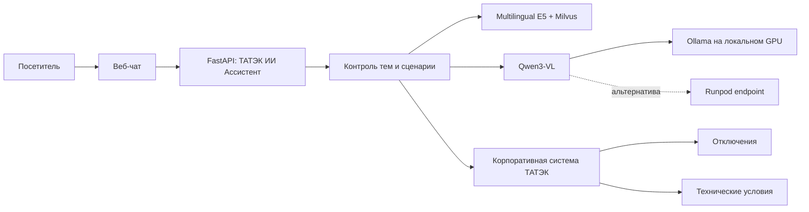

# ТАТЭК ИИ Ассистент

Веб-консультант ТАТЭК для ответов по утверждённым корпоративным материалам, проверки отключений, приёма обращений и оформления заявок на технические условия. Первым каналом является веб-чат; HTTP API отделён от интерфейса, поэтому Telegram и WhatsApp можно подключать отдельными webhook-адаптерами без дублирования логики.

## Быстрый путь: Runpod + веб-чат + RAG

Эта последовательность запускает текущую рабочую конфигурацию с обычным Runpod Pod и Qwen3-VL.

1. Откройте [Runpod Console](https://www.runpod.io/console/pods), выберите свой Pod, нажмите **Start** и дождитесь статуса `RUNNING`.
2. В Pod откройте **Connect** и скопируйте текущие SSH IP/Port: после каждого остановленного Pod порт SSH может измениться. Используйте ключ `~/.ssh/runpod_ed25519`.
3. Выполните в корне проекта команды из раздела [«Обычный Runpod Pod»](#обычный-runpod-pod), чтобы скопировать сервер Qwen на Pod, подготовить CUDA 12.8-окружение и запустить модель на порту `19123`.
4. Откройте [`.env`](.env) и заполните значения ниже. `LLM_API_KEY` - отдельный ключ сервера модели, созданный в Pod; он не равен `RUNPOD_API_KEY`.

```env
LLM_PROVIDER=runpod_pod
LLM_MODEL=tatek-qwen
RUNPOD_POD_ID=ID_ВАШЕГО_POD
RUNPOD_POD_PORT=19123
LLM_API_KEY=ОТДЕЛЬНЫЙ_КЛЮЧ_СЕРВЕРА_МОДЕЛИ
RUNPOD_API_KEY=КЛЮЧ_УПРАВЛЕНИЯ_RUNPOD
```

5. Запустите веб-чат и RAG из Windows PowerShell в `D:\SOURCE\CHAT_LLM`:

```powershell
docker compose up --build -d
Invoke-RestMethod http://localhost:8080/api/health
```

6. Откройте [http://localhost:8080](http://localhost:8080). В `/api/health` должны быть `status: "ok"`, `llm_provider: "runpod_pod"`, `llm_model: "tatek-qwen"` и `rag_ready: true`.
7. Загрузите утверждённые документы ТАТЭК в RAG по инструкции [«Загрузка первого документа в RAG»](#загрузка-первого-документа-в-rag). До этого ассистент намеренно не будет давать справочные ответы без источника.

### Загрузка первого документа в RAG

1. В [`.env`](.env) задайте длинное случайное значение `ADMIN_TOKEN`.
2. Подготовьте утверждённый материал ТАТЭК в формате `.txt`, `.md` или текстового `.pdf`.
3. Выполните в Windows PowerShell:

```powershell
curl.exe -X POST "http://localhost:8080/api/admin/documents" `
    -H "X-Admin-Token: ВАШ_ADMIN_TOKEN" `
    -F "file=@C:\ПУТЬ\К\документу.pdf"
```

Успешный ответ имеет вид `{"document":"документ.pdf","chunks":N}`. Значение `chunks` больше нуля означает, что документ разбит на фрагменты и добавлен в Milvus. После этого задайте вопрос по содержанию документа в веб-чате.

Для обновления базы загружайте новые версии документа отдельным файлом. В production следует добавить версионирование и удаление устаревших фрагментов до публикации базы для абонентов.

## Возможности

- Отвечает только на вопросы, относящиеся к ТАТЭК и электроснабжению.
- Использует RAG: документы ТАТЭК разбиваются на фрагменты, векторизуются и хранятся в Milvus. Модель видит только найденные фрагменты.
- Не отвечает на посторонние вопросы и не придумывает факты при отсутствии подтверждённого контекста.
- Собирает адрес для проверки отключения и вызывает корпоративный API.
- Ведёт диалог оформления технических условий: адрес, мощность, заявитель, контакт, приложение документов и явное подтверждение перед созданием заявки.
- Принимает жалобы. Если маршрут жалоб не настроен, обращение сохраняется в локальной SQLite-базе для передачи специалистам.
- Работает с `Qwen3-VL 8B` через локальный Ollama или через OpenAI-совместимый endpoint Runpod.

## Архитектура



## Быстрый запуск с Ollama

### Требования

- Docker Desktop с Docker Compose.
- Для хорошей скорости Qwen3-VL 8B нужен NVIDIA GPU, доступный Docker Desktop через WSL2. Ollama может работать и на CPU, но для рабочего консультанта это непрактично.
- Открытые локальные порты `8080`, `11434`, `19530`, `9091`.

1. Создайте локальную конфигурацию:

```powershell
Copy-Item .env.example .env
```

2. В [`.env`](.env) заполните как минимум `ADMIN_TOKEN` и `CORPORATE_API_KEY`. Для локальной модели оставьте:

```env
LLM_PROVIDER=ollama
OLLAMA_BASE_URL=http://ollama:11434/v1
LLM_MODEL=qwen3-vl:8b
```

3. Поднимите приложение, Milvus и Ollama:

```powershell
docker compose --profile ollama up --build -d
```

Контейнер `ollama-pull` один раз загрузит `qwen3-vl:8b` в Docker volume. Прогресс можно посмотреть так:

```powershell
docker compose logs -f ollama-pull
```

4. Откройте [http://localhost:8080](http://localhost:8080). Диагностика доступна на [http://localhost:8080/api/health](http://localhost:8080/api/health).

После завершения загрузки модель отвечает через Ollama по внутреннему адресу `http://ollama:11434/v1`. Ключ для Ollama не требуется.

## Запуск с Runpod

Runpod нужен, когда локального GPU ещё нет или его мощности недостаточно. В `.env` переключите провайдер:

```env
LLM_PROVIDER=runpod
RUNPOD_API_KEY=ваш_ключ_runpod
RUNPOD_ENDPOINT_ID=ваш_endpoint_id
LLM_MODEL=Qwen/Qwen3-VL-8B-Instruct
```

Или задайте полный OpenAI-совместимый адрес в `LLM_BASE_URL`. После этого Ollama-профиль не запускается:

```powershell
docker compose up --build -d
```

Backend использует стандартный формат OpenAI Chat Completions. Поэтому замену Qwen или Runpod на другой совместимый сервис можно сделать конфигурацией, без изменения сценариев, RAG и веб-чата.

## Смена модели

Имя модели задаётся единой переменной `LLM_MODEL`, независимо от провайдера. Пользователи чата не могут менять модель: это серверная настройка, поэтому они не смогут подменить используемую модель запросом.

Примеры для Ollama:

```env
# Базовый вариант для текущего MVP
LLM_PROVIDER=ollama
LLM_MODEL=qwen3-vl:8b

# Текстовая Qwen-модель, когда распознавание изображений не требуется
LLM_PROVIDER=ollama
LLM_MODEL=qwen3:8b
```

После изменения `.env` загрузите новую модель и пересоздайте API-контейнер. Это не затрагивает Milvus и уже загруженные документы:

```powershell
docker compose --profile ollama up -d --force-recreate ollama-pull api
docker compose logs -f ollama-pull
```

Для Runpod укажите точное имя, которое обслуживает ваш endpoint:

```env
LLM_PROVIDER=runpod
LLM_MODEL=Qwen/Qwen3-VL-8B-Instruct
RUNPOD_API_KEY=ваш_ключ_runpod
RUNPOD_ENDPOINT_ID=ваш_endpoint_id
```

Для любого другого OpenAI-совместимого сервиса используйте `openai_compatible`:

```env
LLM_PROVIDER=openai_compatible
LLM_BASE_URL=https://llm.example.com/v1
LLM_API_KEY=ключ_сервиса
LLM_MODEL=имя_модели_в_вашем_сервисе
```

### Обычный Runpod Pod

Обычный Pod и Serverless endpoint имеют разные адреса. Значение `RUNPOD_ENDPOINT_ID` можно использовать только для Serverless endpoint. Для Pod сначала запустите внутри него OpenAI-совместимый сервер модели на опубликованном HTTP-порту, затем настройте:

```env
LLM_PROVIDER=runpod_pod
LLM_MODEL=Qwen/Qwen3-VL-8B-Instruct
RUNPOD_POD_ID=идентификатор_pod
RUNPOD_POD_PORT=19123
# Укажите только если vLLM запущен с --api-key
LLM_API_KEY=
```

Адрес будет собран автоматически как `https://<POD_ID>-<PORT>.proxy.runpod.net/v1`. Для защиты API модели запускайте vLLM с `--api-key`, а это же значение храните в `LLM_API_KEY`; ключ управления Runpod (`RUNPOD_API_KEY`) в Pod не передаётся.

Пример запуска Qwen3-VL на Pod с образом `runpod/pytorch` через Jupyter Terminal или SSH:

```bash
pip install --upgrade vllm
vllm serve Qwen/Qwen3-VL-8B-Instruct \
    --host 0.0.0.0 \
    --port 19123 \
    --api-key ЗАДАЙТЕ_ОТДЕЛЬНЫЙ_СЕКРЕТ \
    --gpu-memory-utilization 0.90
```

Порт `19123` должен быть объявлен в настройках Pod как HTTP-порт. После старта проверьте `https://<POD_ID>-19123.proxy.runpod.net/v1/models`, затем перезапустите API-контейнер:

```powershell
docker compose up -d --force-recreate api
```

## Воспроизводимая проверка Runpod Pod

### Что уже было проверено

Проверка, выполненная для текущей конфигурации, дала такие результаты:

| Проверка | Результат | Вывод |
| --- | --- | --- |
| Аутентификация в Runpod GraphQL API | Успешна | `RUNPOD_API_KEY` действителен |
| Список Serverless endpoint | Пустой | В аккаунте нет Serverless endpoint для `LLM_PROVIDER=runpod` |
| Проверка `https://api.runpod.ai/v2/<ID>/runsync` | HTTP `404` | Указанный ID не является Serverless endpoint |
| Список Pod | Найден один работающий Pod | Указанный ID является обычным Pod |
| `/v1/models` на портах Pod | `502` на `19123`, `404` на `8888` | OpenAI-совместимый сервер модели в Pod ещё не запущен |
| Тесты приложения | Успешны, 3 из 3 | Проверены фильтр тем, техусловия и настройка модели |

Ниже приведены команды, чтобы повторить эту диагностику. Они не выводят ключ Runpod и не изменяют ресурсы в облаке.

### 1. Проверить конфигурацию локального проекта

```powershell
Set-Location D:\SOURCE\CHAT_LLM
python -m unittest discover -s tests -v

$env:ENV_FILE = '.env.example'
docker compose --profile ollama config --quiet
```

Обе команды должны завершиться с кодом `0`. Перед запуском контейнеров создайте `.env` из примера и подставьте реальные значения, не добавляя `.env` в Git:

```powershell
Copy-Item .env.example .env
```

### 2. Убедиться, что ключ Runpod действителен

```powershell
Set-Location D:\SOURCE\CHAT_LLM
$values = @{}
Get-Content .env | ForEach-Object {
    if ($_ -match '^\s*([^#=\s]+)\s*=\s*(.*)\s*$') {
        $values[$matches[1]] = $matches[2].Trim('"').Trim("'")
    }
}
$apiKey = if ($values['LLM_API_KEY']) { $values['LLM_API_KEY'] } else { $values['RUNPOD_API_KEY'] }
$body = @{ query = '{ myself { id email } }' } | ConvertTo-Json -Compress
Invoke-RestMethod `
    -Uri ("https://api.runpod.io/graphql?api_key=" + [uri]::EscapeDataString($apiKey)) `
    -Method Post `
    -ContentType 'application/json' `
    -Body $body
```

Успешный ответ содержит `data.myself`. Не публикуйте его вместе с ключом в общий чат или журнал.

### 3. Отличить Serverless endpoint от обычного Pod

```powershell
Set-Location D:\SOURCE\CHAT_LLM
$values = @{}
Get-Content .env | ForEach-Object {
    if ($_ -match '^\s*([^#=\s]+)\s*=\s*(.*)\s*$') {
        $values[$matches[1]] = $matches[2].Trim('"').Trim("'")
    }
}
$apiKey = if ($values['LLM_API_KEY']) { $values['LLM_API_KEY'] } else { $values['RUNPOD_API_KEY'] }
$query = '{ myself { endpoints { id name } pods { id name desiredStatus imageName runtime { ports { privatePort publicPort type } } } } }'
$body = @{ query = $query } | ConvertTo-Json -Compress
$response = Invoke-RestMethod `
    -Uri ("https://api.runpod.io/graphql?api_key=" + [uri]::EscapeDataString($apiKey)) `
    -Method Post `
    -ContentType 'application/json' `
    -Body $body
$response.data.myself | ConvertTo-Json -Depth 8
```

Используйте `LLM_PROVIDER=runpod` и `RUNPOD_ENDPOINT_ID` только при наличии идентификатора в `endpoints`. Если ID находится в `pods`, используйте режим `runpod_pod`.

### 4. Подготовить Pod в консоли Runpod

Для `Qwen/Qwen3-VL-8B-Instruct` выберите GPU с запасом видеопамяти не менее 24 ГБ. Для Pod нужны:

1. образ `runpod/pytorch` или аналогичный образ с CUDA;
2. открытый HTTP-порт `19123` в настройках Pod;
3. доступ к Hugging Face из Pod для первой загрузки весов;
4. Jupyter Terminal или SSH-доступ к Pod.

На Pod с драйвером CUDA `12.8` не выполняйте `pip install --upgrade vllm`: на момент подготовки этого проекта он установил PyTorch CUDA `13.0`, который не запускается с таким драйвером. Вместо него используйте проверенный сервер из [runpod/qwen_openai_server.py](runpod/qwen_openai_server.py). Он запускает Qwen тем же способом, что notebook-проверка: через `transformers`, `Qwen3VLForConditionalGeneration` и `AutoProcessor`, но предоставляет совместимый с OpenAI API.

Скопируйте файлы на Pod с рабочего компьютера. Значения `USER`, IP и SSH-порта возьмите из Runpod Console, а путь к ключу замените при необходимости:

```powershell
scp -i "$HOME\.ssh\runpod_ed25519" -P SSH_PORT `
    runpod\qwen_openai_server.py runpod\requirements-qwen-server.txt `
    USER@POD_IP:/workspace/tatek-qwen-server/
```

Подключитесь к Pod и создайте изолированное Python-окружение с PyTorch CUDA 12.8. Команда не изменяет системные `torch` и `vllm` в исходном образе Pod:

```bash
python3.12 -m venv /workspace/tatek-qwen-env
/workspace/tatek-qwen-env/bin/python -m pip install --upgrade pip
/workspace/tatek-qwen-env/bin/python -m pip install \
    --index-url https://download.pytorch.org/whl/cu128 \
    'torch==2.8.0+cu128' 'torchvision==0.23.0+cu128'
/workspace/tatek-qwen-env/bin/python -m pip install \
    -r /workspace/tatek-qwen-server/requirements-qwen-server.txt
/workspace/tatek-qwen-env/bin/python -c \
    'import torch; print(torch.__version__, torch.version.cuda, torch.cuda.get_device_name(0))'
```

При повторном запуске после остановки Pod проверьте окружение. Если оно отсутствует, повторите только предыдущий блок; модель в `/workspace/hf_cache` сохраняется отдельно и повторно не скачивается:

```bash
test -x /workspace/tatek-qwen-env/bin/python && echo "Qwen environment is ready"
du -sh /workspace/hf_cache
```

Создайте отдельный секрет model API. Он не должен совпадать с `RUNPOD_API_KEY`; сохраните его одновременно в переменной Pod и в `LLM_API_KEY` локального `.env`:

```bash
export TATEK_MODEL_API_KEY="$(openssl rand -hex 32)"
```

Запустите сервер в фоне с логом. На первом старте Qwen загрузит веса в `/workspace/hf_cache`, что может занять несколько минут:

```bash
nohup env \
    PYTHONUNBUFFERED=1 \
    HF_HOME=/workspace/hf_cache \
    HF_XET_HIGH_PERFORMANCE=1 \
    TATEK_MODEL_API_KEY="$TATEK_MODEL_API_KEY" \
    TATEK_SERVED_MODEL=tatek-qwen \
    TATEK_MAX_MODEL_TOKENS=8192 \
    /workspace/tatek-qwen-env/bin/python -m uvicorn qwen_openai_server:app \
    --app-dir /workspace/tatek-qwen-server \
    --host 0.0.0.0 \
    --port 19123 \
    --log-level info \
    > /workspace/tatek-qwen-server/server.log 2>&1 < /dev/null &
```

Проверьте прогресс загрузки и использование GPU:

```bash
tail -f /workspace/tatek-qwen-server/server.log
nvidia-smi
```

Сервер готов, когда `nvidia-smi` показывает занятую видеопамять, а `ss -lptn 'sport = :19123'` выводит `python` или `uvicorn`. Только после этого переходите к проверке API.

#### Если `address already in use`

Ошибка означает, что `19123` уже занят внутри Pod. Выполните команды **в терминале Runpod Pod**, а не в Windows PowerShell:

```bash
# Найти процесс, который слушает порт.
ss -lptn 'sport = :19123'
fuser -v 19123/tcp

# Посмотреть найденный процесс. Подставьте фактический PID.
ps -fp PID
```

Останавливайте процесс, только если `ps` показывает предыдущий `vllm`, `uvicorn` или `python`, запущенный для сервера модели:

```bash
kill PID
ss -lptn 'sport = :19123'
```

Если vLLM-процесс не завершился после обычного `kill`, допустима крайняя мера для этого же подтверждённого PID:

```bash
kill -9 PID
```

После того как `ss` больше не выводит слушатель на `19123`, повторите команду запуска сервера модели из предыдущего шага. Не останавливайте неизвестный процесс: вместо этого добавьте другой HTTP-порт, например `19124`, в настройках Pod Runpod и измените одновременно `--port 19124` в сервере и `RUNPOD_POD_PORT=19124` в `.env`.

### 5. Проверить модель на Pod

Выполните на рабочем компьютере после того, как в выводе vLLM появится строка о готовности сервера. Подставьте ID Pod и отдельный ключ, заданный в предыдущем шаге:

```powershell
$podId = 'ID_ВАШЕГО_POD'
$modelApiKey = 'TATEK_MODEL_API_KEY_ИЗ_POD'
$baseUrl = "https://$podId-19123.proxy.runpod.net/v1"

Invoke-RestMethod `
    -Uri "$baseUrl/models" `
    -Headers @{ Authorization = "Bearer $modelApiKey"; Accept = 'application/json' }

$body = @{
    model = 'tatek-qwen'
    messages = @(@{ role = 'user'; content = 'Reply exactly: RUNPOD_OK' })
    temperature = 0
    max_tokens = 10
} | ConvertTo-Json -Depth 8

Invoke-RestMethod `
    -Uri "$baseUrl/chat/completions" `
    -Method Post `
    -Headers @{ Authorization = "Bearer $modelApiKey"; Accept = 'application/json' } `
    -ContentType 'application/json' `
    -Body $body
```

Ожидаемый ответ второго запроса содержит `choices[0].message.content` со значением `RUNPOD_OK`.

### 6. Включить Pod в ТАТЭК ИИ Ассистенте

После успешного теста поменяйте в `.env` только серверные настройки:

```env
LLM_PROVIDER=runpod_pod
LLM_MODEL=tatek-qwen
RUNPOD_POD_ID=ID_ВАШЕГО_POD
RUNPOD_POD_PORT=19123
LLM_API_KEY=TATEK_MODEL_API_KEY_ИЗ_POD

# Используется только для управления ресурсами Runpod и не передаётся vLLM.
RUNPOD_API_KEY=ВАШ_RUNPOD_API_KEY
```

Запустите API и хранилище RAG без профиля Ollama:

```powershell
Set-Location D:\SOURCE\CHAT_LLM
docker compose up --build -d
docker compose ps
Invoke-RestMethod http://localhost:8080/api/health
```

В ответе `/api/health` ожидаются `llm_provider: "runpod_pod"`, `llm_model: "tatek-qwen"` и `llm_configured: true`. Затем откройте [http://localhost:8080](http://localhost:8080).

### 7. Что делать при ошибках

| Симптом | Причина и действие |
| --- | --- |
| `404` на `api.runpod.ai/v2/<ID>/...` | Это ID обычного Pod. Переключите на `runpod_pod` и используйте proxy URL Pod. |
| `502` на `https://<POD_ID>-19123.proxy.runpod.net/v1/models` | Порт не опубликован или сервер Qwen ещё не запущен. Проверьте порт `19123` в Pod, `/workspace/tatek-qwen-server/server.log` и `nvidia-smi`. |
| `address already in use` при старте сервера | Порт уже слушает другой процесс в Pod. Выполните диагностику `ss` и `fuser` выше, затем остановите только подтверждённый старый сервер модели или выберите новый опубликованный HTTP-порт. |
| `401` на `/v1/models` | Не совпадает `LLM_API_KEY` и значение `--api-key` у vLLM. |
| Ошибка вида `driver on your system is too old` | Использован PyTorch CUDA выше драйвера Pod. Пересоздайте `/workspace/tatek-qwen-env` и выполните установку `torch==2.8.0+cu128` из этого раздела. |
| Ошибка памяти CUDA | Выберите GPU с большей VRAM, снизьте `--gpu-memory-utilization` или используйте меньшую модель. |
| Первый запрос долго ждёт | Модель ещё скачивается или загружается в GPU. Проверьте логи vLLM и дождитесь сообщения о готовности сервера. |

## База знаний RAG

Пользовательские ответы разрешаются только если Milvus возвращает релевантные фрагменты утверждённых документов. До загрузки материалов ответы по справочной информации намеренно не выдаются.

Загрузите `.txt`, `.md` или текстовый `.pdf` от имени администратора:

```powershell
curl.exe -X POST "http://localhost:8080/api/admin/documents" -H "X-Admin-Token: ваш_ADMIN_TOKEN" -F "file=@C:\docs\pravila-teh-usloviy.pdf"
```

Сервис применяет модель эмбеддингов `intfloat/multilingual-e5-small`; при первом запуске она будет загружена из Hugging Face. Для закрытого контура образ и веса следует заранее поместить во внутренний registry или кэш.

## Корпоративный API

Базовый адрес и секрет передаются только серверу:

```env
CORPORATE_API_BASE_URL=http://host.docker.internal:90
CORPORATE_API_KEY=секретный_ключ
```

Опубликованная документация на `http://localhost:90/docs/` подтверждает заголовок `X-API-KEY` и следующие используемые операции:

| Сценарий | Метод и путь |
| --- | --- |
| Список отключений | `GET /api/disconnection/disconnections` |
| Поиск техусловий | `POST /api/technical_condition/find` |
| Создание/обновление техусловий | `POST /api/technical_condition/save` |

Для точного ответа на вопрос «почему нет света по моему адресу» необходим маршрут, который сопоставляет адрес абонента с `substation_name` и `line_name`. Его нет в опубликованной документации, поэтому обязательно получите контракт у команды корпоративной системы и заполните:

```env
CORPORATE_API_SUBSCRIBER_LOOKUP_PATH=/ваш/маршрут/поиска/абонента
```

Проверка свободной мощности также требует подтверждённого корпоративного маршрута:

```env
CORPORATE_API_CAPACITY_PATH=/ваш/маршрут/свободной-мощности
```

До настройки этих путей ассистент честно сообщает, что автоматическая проверка недоступна, и не выдумывает результат.

Эндпоинт сохранения техусловий требует поля, состав которых зависит от вашей инсталляции. При необходимости задайте значения по умолчанию:

```env
TECHNICAL_CONDITION_STATUS_ID=13
TECHNICAL_CONDITION_OBJECT_ID=14
```

В текущей публичной документации нет маршрута загрузки вложений к заявке и маршрута создания жалоб. Документы заявки сохраняются в `data/uploads/`, проходят структурную проверку и ожидают ручной проверки специалистом. После получения утверждённых путей заполните `CORPORATE_API_COMPLAINT_PATH` и добавьте в интеграцию контракт передачи файлов. Не следует считать вложение переданным в корпоративную систему, пока такой маршрут не предоставлен.

## Что проверяется в заявке

| Этап | Текущая проверка |
| --- | --- |
| Адрес, мощность, заявитель, контакт | Наличие; мощность должна быть положительной и не превышать 100 000 кВт |
| PDF | Открывается, не зашифрован, содержит страницы; скан без текстового слоя отмечается для ручной проверки |
| JPG/PNG | Целостность изображения |
| Содержимое паспорта, правоустанавливающих и проектных документов | Только ручная проверка до согласования требований и юридически допустимой ML-проверки |
| Создание заявки | Только после сообщения `подтверждаю` |

## Безопасность и эксплуатация

- `.env` не добавляется в Git. Не передавайте ключи Runpod, `X-API-KEY` и `ADMIN_TOKEN` в чат.
- Перед внешним запуском добавьте аутентификацию пользователей, rate limit, аудит, антивирусную проверку вложений, шифрование хранилища и политику хранения персональных данных.
- Диалоги в текущем MVP хранятся в памяти процесса. Для нескольких реплик API или каналов Telegram/WhatsApp перенесите состояние диалогов в Redis.
- `data/` содержит Milvus, SQLite и вложения; его нужно включить в резервное копирование и ограничить права доступа.
- Перед открытием для абонентов проведите тесты с реальными ответами API и согласуйте тексты с юридической службой и службой поддержки ТАТЭК.

## Каналы после веб-версии

Веб-чат использует `POST /api/chat` с `message` и опциональным `conversation_id`. Telegram- и WhatsApp-адаптеры должны принимать webhook от канала, связывать идентификатор пользователя с `conversation_id` и вызывать тот же API. Создание заявок и жалоб остаётся в backend: токены каналов и корпоративный API-ключ никогда не передаются браузеру или модели.

## Полезные команды

```powershell
# Статус контейнеров
docker compose ps

# Логи сервиса
docker compose logs -f api

# Остановить сервисы, сохранив данные
docker compose down

# Остановить и удалить данные локальной разработки
docker compose down -v
```